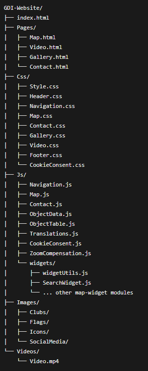

# **GDI Website**

A static, browser-based website built with HTML, CSS and JavaScript. The application provides an ArcGIS map, an objects table, a photo gallery, a video page and a contact page. It also includes multilingual interface text and a cookie-consent interface.

This project does not currently require a custom application server, a database, Node.js, or a compilation/build step. It does need to be served over HTTP/HTTPS during development because the application loads page fragments with fetch() and loads JavaScript modules dynamically.

## **Features**
- Map: ArcGIS map view with a GDI-hosted map service and map tools/widgets.
- Map widgets: Search, layer list, basemap gallery, legend, scale bar, bookmarks, coordinate conversion, distance and area measurement, locate, print, compass, sketch and elevation profile. The exact enabled set is controlled by the map implementation and its widget modules.
- Objects table: Displays map objects and supports searching, sorting, pagination, page-size selection and CSV export. Selecting a table record can be connected to the map selection/popup behaviour.
- Gallery: Bootstrap carousel displaying images from the Images folder.
- Video: HTML5 video player using a local video file.
- Contact: Contact form and an ArcGIS map showing the office location.
- Languages: Macedonian, English and Albanian translations managed by the application's translation script.
- Cookie consent: Consent choices and preferences stored in browser localStorage.
- Responsive layout: Bootstrap grid/components and project-specific CSS provide desktop, tablet and mobile layouts.

## Technology stack

| **Technology** | **Purpose** | **Version / source** |
|---|---|---|
| HTML5 | Page structure and content | Browser standard |
| CSS3 | Styling and responsive layout | Browser standard |
| JavaScript | Navigation, data handling, widgets and interactions | Browser standard; native ES modules are used for the map |
| Bootstrap | Grid, responsive utilities, carousel, offcanvas and other UI components | 5.3.3 via jsDelivr CDN |
| ArcGIS Maps SDK for JavaScript | Map view, layers and ArcGIS widgets/components | 5.0 via Esri CDN |
| Web3Forms | Contact-form submission endpoint | External service |
| GDI ArcGIS service | Map/object data | `gisserver.gdi.mk` ArcGIS REST service |

## Architecture

### 1. Static entry point

**index.html** is the main document. It loads the external libraries, project CSS files and the main JavaScript files. The header, navigation sidebar, main-content container, footer and cookie-consent section are part of this document.

The main scripts are loaded as deferred scripts. The ArcGIS map is not loaded as a separate static page script; the map module is imported when the Map page is opened.

### 2. Hash-based page navigation
   
**Js/Navigation.js** provides lightweight client-side navigation. A navigation link changes the URL hash, for example #Map, #Gallery or #Contact.

### 3. ArcGIS map module
   
**Js/Map.js** is dynamically imported when the Map page is opened. It creates the map, connects the GDI service layer, configures the map view and brings together widget modules from Js/widgets/.

### 4. Objects data and table
The objects table is part of the Map page. Its responsibilities are separated across the data and table scripts:

- **Js/ObjectData.js** handles retrieval/preparation of object data.
- **Js/ObjectTable.js** handles the table interface, including search, sorting, pagination, page size and export.

### 5. Contact page

   **Pages/Contact.html** contains the contact form and contact-map container. Js/Contact.js initializes and destroys the contact ArcGIS view and handles form submission to Web3Forms.

### 6. Translations

   **Js/Translations.js** contains the application's language strings and translation helpers. Elements marked with data-i18n, data-i18n-placeholder and related attributes are translated when a page is loaded or the language changes. Other scripts can use the shared translation function and listen for the site-language-changed event.

### 7. Cookie consent

   **Js/CookieConsent.js** controls the cookie-consent interface. The user's choice is stored in localStorage under the application's consent key. The script also dispatches a cookie-consent-updated event so other scripts can react to a change in consent.

### 8. Zoom compensation
   

**Js/ZoomCompensation.js** contains the project's browser-zoom compensation logic for selected page elements. It uses devicePixelRatio, viewport resize events and DOM updates to apply CSS transforms and preserve layout space.

## Project structure

## Run locally

1. Install Visual Studio Code.
2. Open the complete project folder (the folder containing index.html).
3. Install the Live Server extension.
4. Right-click index.html and choose Open with Live Server.
5. Open the local HTTP address shown by the extension, commonly something like http://127.0.0.1:5500/.
   Keep the project root as the server's root so paths such as Pages/Map.html, Css/Map.css and Images/... resolve as expected.